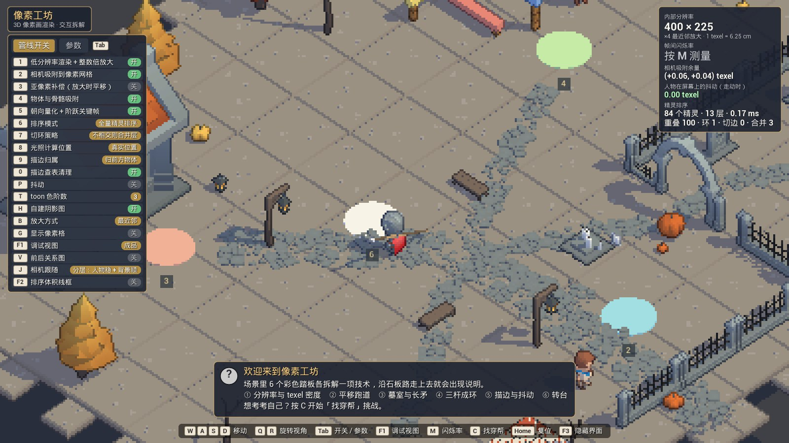
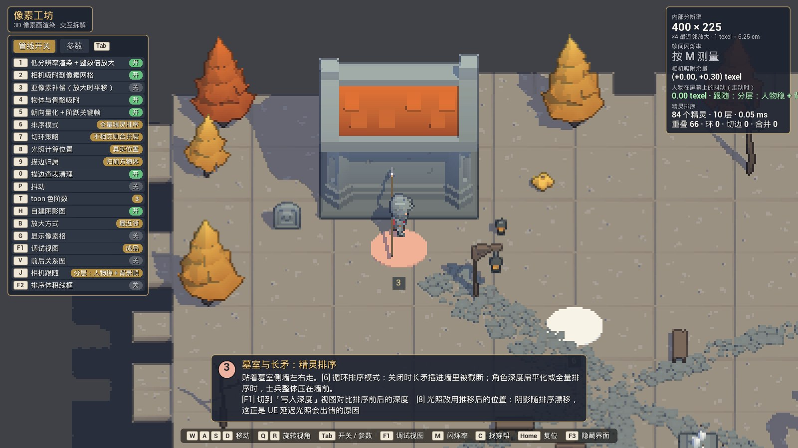
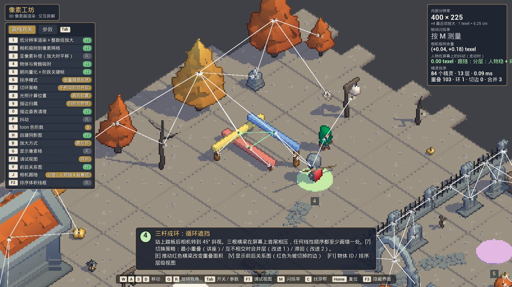
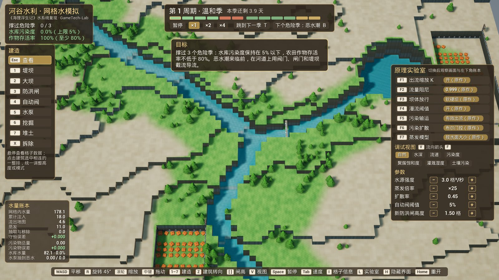
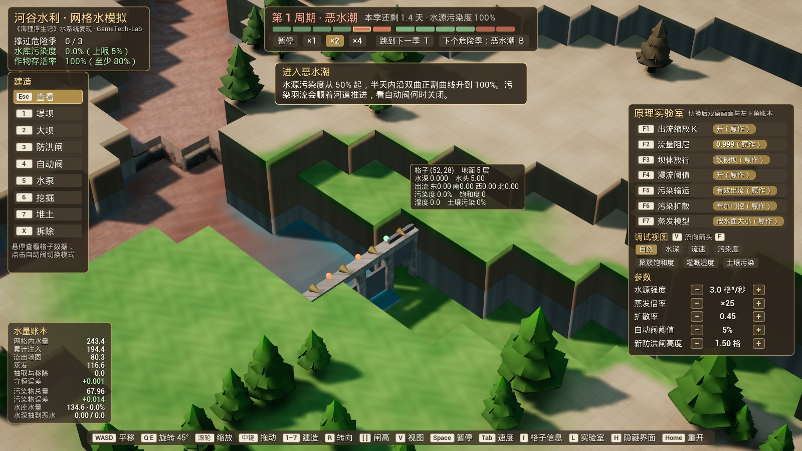
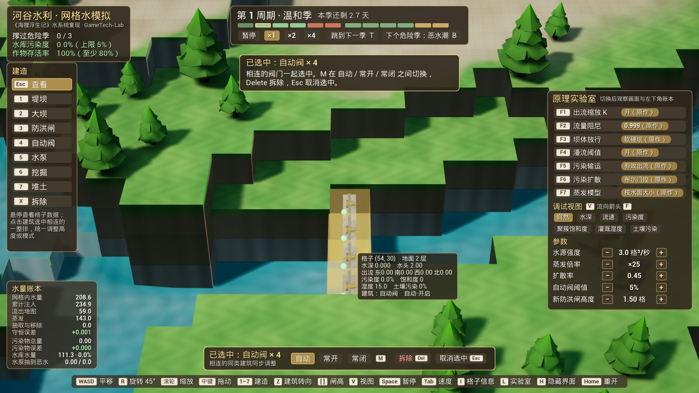

# GameTech-Lab

研究游戏开发中可能用到的各种技术栈，并在 Unreal Engine 5.8 中做成可交互的复现 Demo。每个技术对应一个独立的工程仓库，本仓库是它们的总览。

## 工程一览

| 主题 | 工程仓库 | 状态 |
|---|---|---|
| [声音遮挡、阻挡与衍射](#gtl-audio-occlusion声音遮挡阻挡与衍射) | [GTL-Audio-Occlusion](https://github.com/RudAns/GTL-Audio-Occlusion) | 已完成 |
| [3D 场景实时渲染成像素画](#gtl-render-pixelart3d3d-场景实时渲染成像素画) | [GTL-Render-PixelArt3D](https://github.com/RudAns/GTL-Render-PixelArt3D) | 已完成 |
| [《海狸浮生记》的网格水](#gtl-physics-gridwater海狸浮生记的网格水) | [GTL-Physics-GridWater](https://github.com/RudAns/GTL-Physics-GridWater) | 已完成 |
| [《盗贼之海》式的共享海面](#gtl-net-sharedocean盗贼之海式的共享海面) | [GTL-Net-SharedOcean](https://github.com/RudAns/GTL-Net-SharedOcean) | 未完成 |

---

## GTL-Audio-Occlusion：声音遮挡、阻挡与衍射

**仓库**：[RudAns/GTL-Audio-Occlusion](https://github.com/RudAns/GTL-Audio-Occlusion) · **状态**：已完成

**研究什么**：墙后、门外、楼上的声音应当如何衰减、滤波并改变方向。调研比较了 Wwise Spatial Audio、Steam Audio、微软 Project Acoustics、FMOD、CRI ADX 与 UE5 原生方案，以及卡普空 RE ENGINE、《彩虹六号：围攻》、《守望先锋》等作品的公开做法。核心结论是：遮挡问题的关键不在“直线上有没有墙”，而在“声音经哪条路到达”。已上线作品的共识结构是“空间拓扑 → 传播路径 → 少量参数”，射线只用于同一空间内的局部阻挡；衍射损失按路径的超额程差（excess path length）分频段计算，比按拐角角度映射更接近物理，且几乎不增加开销。房间—门户方案可以完整用在手游上。

**Demo 里能做什么**：在一座六个房间的“声屋”里，收音机、机床、座钟、篝火、测试音箱和巡逻者同时发声（需戴耳机，全部走 Steam Audio HRTF 双耳渲染）。

- 左侧面板按真实依赖关系组织：先单选处理方案（不处理、UE 原生、自研管线、GPU 波动烘焙、Steam Audio），再勾选该方案下的子层，从多射线阻挡、房间—门户路径、分频衍射、穿墙透射一路叠加到房间混响耦合与时间平滑。
- 六组 A/B（/C）对照：二值遮挡的跳变、路径是否从正确的门口传来、按角度与按程差两种衍射映射、三种方案级实现的听感与开销。
- 开关门可以听到声音改道；路径、虚拟声源、透射命中点、烘焙探针和声场切片都可以画在场景里，第一人称和俯视视角之间可随时切换。

| 第一人称：路径与透射的分频衰减读数 | GPU 波动烘焙：直达声响度切片与探针 |
|---|---|
|  |  |

---

## GTL-Render-PixelArt3D：3D 场景实时渲染成像素画

**仓库**：[RudAns/GTL-Render-PixelArt3D](https://github.com/RudAns/GTL-Render-PixelArt3D) · **状态**：已完成

**研究什么**：如何让 3D 场景在运动中仍然像手绘像素画一样干净稳定。调研以 Hypersect 工作室在 GDC 2026 上分享的《Never's End》渲染方案为主线：低分辨率渲染加整数倍最近邻放大、相机与物体吸附到像素网格以消除像素爬行（pixel creep）、亚像素补偿、朝向量化与阶跃关键帧，以及最关键的精灵排序（sprite sorting），即让每个物体整体作为一层绘制、而光照仍按真实位置计算，并处理三个物体互相遮挡成环时的切环策略。

**Demo 里能做什么**：操控一名骑士在像素风墓园里走动，场景中六个彩色踏板各对应一项技术，走上去就出现原理说明。

- 左侧“管线开关”逐项控制低分辨率、吸附、排序模式、切环策略、光照位置、描边归属、抖动、toon 色阶、相机跟随方式等十几项技术，另有参数页可以实时调像素尺寸、每米像素数、俯角和光源方向；视角按 45° 一档旋转。
- 运动时的稳定性是重点：相机连续跟随、背景按亚像素平滑滚动，角色和它的影子在放大时单独成层、不随背景偏移，因此角色在屏幕上纹丝不动，背景也不会整格跳；按 J 可以和缓动跟随、锁定像素等做法对比，右上角实时显示角色在屏幕上的抖动。
- 调试视图可显示物体 ID、排序层级、真实深度与推移后深度，以及物体之间的前后关系图；按 M 通过 GPU 回读实测帧间闪烁率；挑战模式会随机关掉一项技术，让玩家猜是哪一项。

| 精灵排序：长矛整体画在墓室墙前 | 三杆成环：互不相交的合并成一层 |
|---|---|
|  |  |

---

## GTL-Physics-GridWater：《海狸浮生记》的网格水

**仓库**：[RudAns/GTL-Physics-GridWater](https://github.com/RudAns/GTL-Physics-GridWater) · **状态**：已完成

**研究什么**：城建游戏《海狸浮生记》（Timberborn，Mechanistry 开发）如何在大网格上实时模拟可被玩家改造的水系。调研拆解了它的虚拟管道法（virtual pipes）水流、恶水潮污染度的平流与门控扩散、按水深与聚簇大小分档的蒸发、灌溉湿度与土壤污染，以及大坝、防洪闸、自动阀等水利建筑的约束方式；同时指出原作在质量守恒上的缺口，提出半隐式摩擦、质量守恒的污染输运等改进。

**Demo 里能做什么**：一个可交互的河谷水系模拟，季节在温和季与危险季（干旱或恶水潮）之间循环，可以随时改造地形和水利设施，观察水流、污染和灌溉的变化。

- 可以建堤坝、大坝、防洪闸、自动阀、水泵，挖掘或堆土改变地形，水流、污染和灌溉范围会立即响应。相邻的同类建筑自动连成一排，点击即可选中整排，统一调整闸门高度或阀门模式。
- 右侧“原理实验室”中的七项开关可以在原作做法与改进方案之间逐项切换，左下角的水量账本实时显示守恒误差，关掉出流比例缩放后能看到误差持续增长。
- 调试视图可显示水深、流速、污染度、聚簇饱和度、灌溉湿度和土壤污染；季节可以快进，也可以直接跳到下一个危险季。

| 恶水潮：自动阀截断污染，水库保持清洁 | 相连的自动阀整排选中、统一切换模式 |
|---|---|
|  |  |

---

## GTL-Net-SharedOcean：《盗贼之海》式的共享海面

**仓库**：[RudAns/GTL-Net-SharedOcean](https://github.com/RudAns/GTL-Net-SharedOcean) · **状态**：未完成

**研究什么**：Rare 的多人航海游戏《盗贼之海》（Sea of Thieves，2018）如何让每个玩家看到同一片起伏的大海、同一条随浪摇晃的船。调研涵盖 Tessendorf FFT 海浪的频谱与级联划分、玩法波段（CPU，服务器与物理都要读取）与画面波段（GPU）的拆分、浮力探针与平面拟合两种浮力模型，以及多人一致性的关键：各端在同步的网络时钟下各自确定性地计算海面，船体由服务器权威模拟，客户端用快照插值并按本地海面重建竖直运动。

**Demo 里能做什么**：一个可联机的航海小游戏，可以单机运行，也可以在同一台机器上并排开主机和客户端对比两端画面。

- 在甲板上走动，走到船尾舵轮旁掌舵，升降帆、转舵，在海岛之间航行、收集漂流宝箱，穿过会移动的风暴区。
- “原理实验台”按“海面与巨浪 / 船体浮力 / 多人一致性”三组分层列出开关：海面分层着色、浮力探针数量与浮力模型、服务器物理频率、海浪时钟模式、船的三种呈现方式、模拟网络延迟等，标明哪些作用于服务器、哪些作用于客户端。
- 网络仪表实时显示往返时间、两端海浪时钟误差与吃水偏差；快照幽灵用线框画出最新快照与插值回放位置之间的差距。
